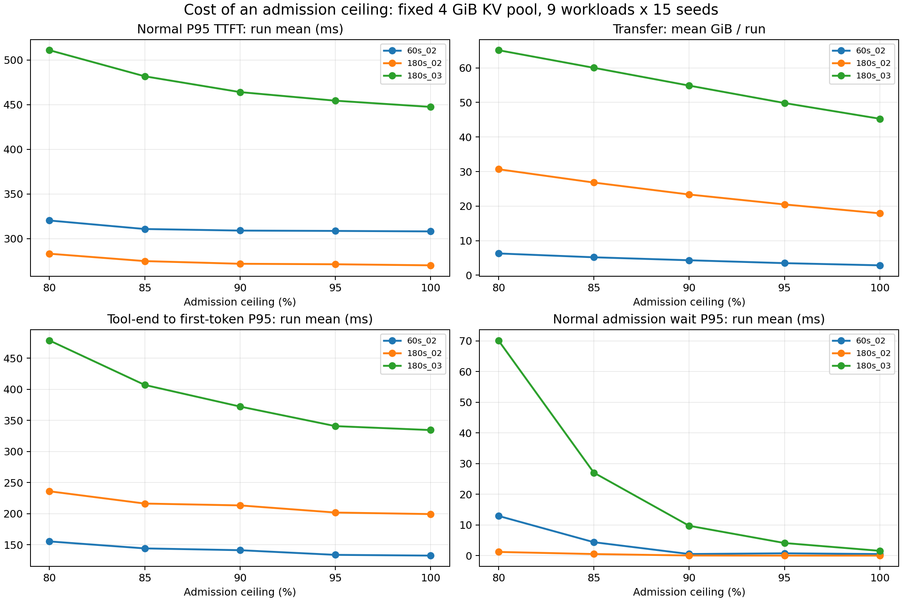

# Watermark 입장 상한의 비용: 보조 민감도 분석

작성: 2026-11-03. 이 자료는 **미리 정한 GPU 여유 제약을 적용할 때 추가되는 비용**을 기록한다. 상한을 낮추면 회수가 빨라진다는 예상 가능한 방향을 새로운 발견으로 제시하지 않는다. 확보한 여유 공간을 실제로 사용하는 부하나 운영 기능은 모델에 넣지 않았으므로, 그 여유의 서비스 이득이나 최적 상한을 평가하는 실험은 아니다.

[사전 계획](week10_watermark_ceiling_plan.md)의 입력·판정으로 실행했다. 기준 커밋 `80404dc`, 상한 80·85·90·95·100%, LRU, 기존 세 설정·9조건·seed 0~14, 총 2,430회다. 실행 횟수는 비교 범위이며 연구 기여의 근거가 아니다. 엔진·정책 선택 규칙·기존 기본값·SLO는 바꾸지 않았다. 아래 해석 범위 정리는 실행 후 작성했으며 사전 가설이나 원자료를 소급 변경하지 않았다.

## 1. 이 자료가 답하는 질문과 답하지 못하는 질문

| 질문 | 이 자료에서 확인한 범위 |
|---|---|
| 상한을 강제할 때 전송·입장 대기·normal 지연·복귀 지연이 얼마나 바뀌는가 | 같은 입력의 정책별 비용 차이를 측정했다. |
| 할당 블록이 상한을 넘지 않는가 | 구현 불변식을 검증했다. 사용자 성능 개선의 증거로 취급하지 않는다. |
| GPU 공간을 10% 남겨야 하는가 | 그 운영 근거를 이 실험으로 검증하지 않았다. |
| 남겨둔 공간이 처리량·지연·거절을 개선하는가 | 여유 공간의 활용 효과를 검증할 조건을 설계하지 않았다. |
| 어느 상한이 최적인가 | 서비스 목적함수·선택 기준·독립 평가를 정하지 않았으므로 결론을 내리지 않는다. |

### 주 설정에서 LRU 대비 관측한 비용

180초·stress 0.2/s의 9조건 × 15 seed에서 run별 지표를 평균한 값이다. 거절률은 최대, 완료율은 측정 대상 세션 수로 계산했다.

| 지표 | LRU | Watermark 90% | 90% − LRU |
|---|---|---|---|
| normal P95(ms) | 270.06 | 271.79 | +1.74ms |
| 전송(GiB/run) | 17.92 | 23.36 | +30.39% |
| 복귀 P95(ms) | 199.48 | 213.43 | +13.94ms |
| normal 거절률 최대(%) | 0.00 | 0.00 | 차이 없음 |
| stress 완료율(%, drain 포함) | 100.00 | 100.00 | 차이 없음 |

이 집계에서는 Watermark 90%의 normal·복귀 평균 지연이 LRU보다 길고 전송도 많았다. 거절·완료율의 이득은 관찰되지 않았다. 개별 조건·seed의 변화는 다를 수 있지만, 이 결과를 사용자 성능 개선의 증거로 쓰지 않는다. 90% 이하를 유지한 사실은 별도의 메모리 제약 충족으로 분리한다.

### 상한을 더 낮췄을 때의 추가 비용

주 설정에서 90%→80%로 **보장되는 최소 여유**를 10%p 늘릴 때 전송량은 **31.30%**, normal P95 평균은 **+11.27ms**, 복귀 P95 평균은 **+22.69ms** 증가했다. 135개의 입력 쌍 중 normal P95가 증가한 것은 48쌍, 감소 20쌍, 동일 67쌍이다. 평균의 방향을 모든 요청의 법칙으로 일반화하지 않는다.

180초·0.3/s에서는 같은 변경의 normal P95 평균 차이가 **+46.93ms**, 복귀 P95 평균 차이가 **+106.26ms**였다. normal 입장 대기 P95 평균은 **9.72→70.14ms**였다. 이것은 해당 환경에서 관측한 비용 크기이며 90%를 기본값으로 선택할 근거는 아니다.

낮은 상한은 작은 GPU KV 풀로 바꾼 실험이 아니라 동일한 4GiB 풀에서 새 턴이 사용할 수 있는 예약량만 제한한 것이다. 확보한 여유 공간이 실제로 다른 작업의 처리량을 늘리는지는 이 실험에서 측정하지 않았다.

## 2. 전체 조건 평균

각 행은 9조건 × 15 seed의 **run별 지표 평균**이다. normal 거절률은 최대이고, stress 완료율은 세션 수로 계산했다. normal 입장 대기 P95와 전체 TTFT P95는 각각 계산한 값이므로 더하거나 빼서 지연을 분해하면 안 된다. 비용은 같은 기간·같은 설정 안에서 상한끼리 비교한다. 기존 SLO 집계는 4절의 보조 자료로 분리했다.

### 60s_02

| 상한 | normal P95(ms) | 입장 대기 P95(ms) | 전송(GiB/run) | 복귀 P95(ms) | normal 거절률 최대(%) | stress 완료율(%) |
|---|---|---|---|---|---|---|
| LRU(100%) | 308.06 | 0.50 | 2.87 | 132.73 | 0.00 | 100.00 |
| 80% | 320.27 | 12.94 | 6.31 | 155.52 | 0.00 | 100.00 |
| 85% | 310.74 | 4.37 | 5.20 | 144.31 | 0.00 | 100.00 |
| 90% | 308.98 | 0.51 | 4.33 | 141.42 | 0.00 | 100.00 |
| 95% | 308.60 | 0.75 | 3.50 | 133.93 | 0.00 | 100.00 |
| 100% | 308.06 | 0.50 | 2.87 | 132.73 | 0.00 | 100.00 |

### 180s_02

| 상한 | normal P95(ms) | 입장 대기 P95(ms) | 전송(GiB/run) | 복귀 P95(ms) | normal 거절률 최대(%) | stress 완료율(%) |
|---|---|---|---|---|---|---|
| LRU(100%) | 270.06 | 0.00 | 17.92 | 199.48 | 0.00 | 100.00 |
| 80% | 283.07 | 1.20 | 30.67 | 236.12 | 0.00 | 100.00 |
| 85% | 274.80 | 0.51 | 26.82 | 216.41 | 0.00 | 100.00 |
| 90% | 271.79 | 0.03 | 23.36 | 213.43 | 0.00 | 100.00 |
| 95% | 271.25 | 0.00 | 20.49 | 201.94 | 0.00 | 100.00 |
| 100% | 270.06 | 0.00 | 17.92 | 199.48 | 0.00 | 100.00 |

### 180s_03

| 상한 | normal P95(ms) | 입장 대기 P95(ms) | 전송(GiB/run) | 복귀 P95(ms) | normal 거절률 최대(%) | stress 완료율(%) |
|---|---|---|---|---|---|---|
| LRU(100%) | 447.52 | 1.56 | 45.29 | 334.54 | 0.00 | 100.00 |
| 80% | 511.05 | 70.14 | 65.12 | 478.57 | 0.00 | 100.00 |
| 85% | 481.80 | 27.04 | 60.03 | 407.08 | 0.00 | 100.00 |
| 90% | 464.11 | 9.72 | 54.88 | 372.32 | 0.00 | 100.00 |
| 95% | 454.48 | 4.10 | 49.83 | 340.88 | 0.00 | 100.00 |
| 100% | 447.52 | 1.56 | 45.29 | 334.54 | 0.00 | 100.00 |

전체 실행에서 normal 거절률 최댓값은 **0.00%**, 재계산 토큰 최댓값은 **0**다. 모든 변형에서 측정 대상 stress 세션은 drain까지 포함해 **100% 완료**했고, stress 복귀 턴의 거절도 0건이었다. 입력 기간 안에 전부 완료했다는 뜻은 아니다. 완료 수 / 제출 수는 원값·`aggregate.csv`에 보존했다.

## 3. 대표 조건 both_4x

아래는 조건을 `both_4x`로 고정한 seed 15개의 평균이다. 9조건 평균과 혼합하지 않는다. 여유 공간 자체를 사용하는 서비스 이득은 측정하지 않았다.

### 60s_02

| 상한 | normal P95(ms) | 입장 대기 P95(ms) | 전송(GiB/run) | 복귀 P95(ms) |
|---|---|---|---|---|
| LRU(100%) | 404.86 | 0.26 | 3.58 | 64.48 |
| 80% | 410.47 | 0.00 | 6.12 | 71.30 |
| 85% | 406.07 | 0.00 | 5.49 | 70.48 |
| 90% | 404.17 | 0.00 | 5.10 | 68.46 |
| 95% | 403.28 | 0.00 | 4.31 | 71.65 |
| 100% | 404.86 | 0.26 | 3.58 | 64.48 |

### 180s_02

| 상한 | normal P95(ms) | 입장 대기 P95(ms) | 전송(GiB/run) | 복귀 P95(ms) |
|---|---|---|---|---|
| LRU(100%) | 324.69 | 0.00 | 25.44 | 151.10 |
| 80% | 333.83 | 0.00 | 31.87 | 171.37 |
| 85% | 332.18 | 0.00 | 30.65 | 163.95 |
| 90% | 327.18 | 0.00 | 28.40 | 155.39 |
| 95% | 326.97 | 0.00 | 26.88 | 149.19 |
| 100% | 324.69 | 0.00 | 25.44 | 151.10 |

### 180s_03

| 상한 | normal P95(ms) | 입장 대기 P95(ms) | 전송(GiB/run) | 복귀 P95(ms) |
|---|---|---|---|---|
| LRU(100%) | 626.51 | 2.27 | 48.47 | 238.15 |
| 80% | 649.15 | 68.28 | 60.78 | 297.33 |
| 85% | 646.54 | 19.22 | 57.33 | 264.11 |
| 90% | 627.47 | 4.97 | 53.49 | 248.65 |
| 95% | 624.64 | 3.11 | 50.69 | 225.18 |
| 100% | 626.51 | 2.27 | 48.47 | 238.15 |

## 4. 보조 집계: 기존 SLO와 할당 제약

SLO 통과 수는 정책의 서비스 품질 순위가 아니다. 특히 상한 80~90%에서는 Peak 기준을 구조적으로 만족하며, 95~100%에서는 더 큰 할당량을 허용한다. 아래는 기존 판정의 구성 요소를 분리한 것이다. 각 통과 수의 분모는 135회다.

| 상한 | 상대 TTFT 통과 /135 | 거절률 통과 /135 | Peak 통과 /135 | 전체 통과 /135 | 관측 최대 Peak(%) |
|---|---|---|---|---|---|
| LRU(100%) | 134 | 135 | 5 | 5 | 100.00 |
| 80% | 134 | 135 | 135 | 134 | 80.00 |
| 85% | 134 | 135 | 135 | 134 | 85.00 |
| 90% | 134 | 135 | 135 | 134 | 90.00 |
| 95% | 134 | 135 | 5 | 5 | 95.00 |
| 100% | 134 | 135 | 5 | 5 | 100.00 |

### 조건별 전체 통과 수

각 셀은 seed 15개 중 통과 수다. 상한과 무관하게 기존 Peak 90%·거절률 10%·자기 변형 W0 P95의 3배를 그대로 적용했다. 구현으로 보장되는 제약 충족과 관측한 지연·거절을 혼합해 최적 상한을 선정하지 않는다.

| 상한 | w0_1x | base_2x | burst_2x | wait_2x | both_2x | base_4x | burst_4x | wait_4x | both_4x |
|---|---|---|---|---|---|---|---|---|---|
| 80% | 15 | 15 | 15 | 15 | 15 | 15 | 15 | 15 | 14 |
| 85% | 15 | 15 | 15 | 15 | 15 | 15 | 15 | 15 | 14 |
| 90% | 15 | 15 | 15 | 15 | 15 | 15 | 15 | 15 | 14 |
| 95% | 5 | 0 | 0 | 0 | 0 | 0 | 0 | 0 | 0 |
| 100% | 5 | 0 | 0 | 0 | 0 | 0 | 0 | 0 | 0 |

## 5. 같은 입력에서 상한 90% 대비 변화

180s_02의 normal P95 차이이며, 양수는 해당 변형이 90%보다 길다는 뜻이다. 먼저 각 seed에서 9조건 평균 차이를 계산한 뒤 seed 15개를 2,000회 재표집했다. 구간은 보조적인 불확실성 표시이며 다중 비교 유의성 검정이나 최적값 선택 근거가 아니다. 동일·증가·감소 수는 조건·seed별 135쌍에서 계산하므로 bootstrap 표본 수와 다르다.

| 상한 | normal P95 차이(ms) | seed bootstrap 95% 구간 | 증가 / 감소 / 동일 (135쌍) |
|---|---|---|---|
| lru_offload | -1.74 | [-3.10, -0.33] | 14 / 36 / 85 |
| watermark_c0.8 | 11.27 | [5.53, 17.38] | 48 / 20 / 67 |
| watermark_c0.85 | 3.00 | [-0.54, 6.96] | 33 / 25 / 77 |
| watermark_c0.9 | 0.00 | [0.00, 0.00] | 0 / 0 / 135 |
| watermark_c0.95 | -0.55 | [-2.15, 0.96] | 16 / 24 / 95 |
| watermark_c1 | -1.74 | [-3.10, -0.33] | 14 / 36 / 85 |

전송·복귀 지연·입장 대기의 같은 분석은 `paired_vs90.csv`에 있다. 임계값 변경으로 입장·복귀 시각과 회수 대상이 달라지므로, 전송·지연의 단조 증가를 전제하지 않는다.

### 과부하에서 85%가 더 많이 통과한 이유

180s_03에서 85%는 128/135, 90%는 124/135다. 그러나 85%의 절대 normal P95 평균은 **481.80ms**로 90%의 **464.11ms**보다 길다. 두 변형의 통과 여부가 달라진 실행은 다음과 같다.

| 설정 | 조건 | seed | 90% 통과 | 85% 통과 | 90% P95(ms) | 85% P95(ms) | 90% W0(ms) | 85% W0(ms) |
|---|---|---|---|---|---|---|---|---|
| 180s_03 | burst_2x | 14 | False | True | 871.17 | 888.33 | 276.87 | 325.18 |
| 180s_03 | both_2x | 14 | False | True | 848.16 | 823.23 | 276.87 | 325.18 |
| 180s_03 | both_2x | 5 | True | False | 432.58 | 457.82 | 147.52 | 147.52 |
| 180s_03 | burst_4x | 12 | False | True | 1,075.80 | 1,059.48 | 321.02 | 380.29 |
| 180s_03 | burst_4x | 14 | False | True | 871.17 | 871.17 | 276.87 | 325.18 |
| 180s_03 | both_4x | 14 | False | True | 848.16 | 916.63 | 276.87 | 325.18 |

예를 들어 `burst_2x` seed 14는 90%에서 871.17ms, 85%에서 888.33ms로 오히려 느려졌지만 TTFT 판정은 실패→통과다. 해당 변형 W0가 276.87→325.18ms로 느려지면서 비율이 3.15→2.73배가 됐기 때문이다. 반대로 절대 지연 자체가 개선된 사례도 있으므로 전부 같은 이유라고 하지 않는다. 이 사례들은 기존 상대 SLO 통과 수와 절대 성능을 함께 읽어야 한다는 근거다.

80·85·90%에서 남은 실패는 모두 **상대 TTFT 하나의 실패**였고 거절률·Peak는 통과했다. SLO 기준을 바꾸거나 통과 수에 맞춰 기본값을 조정하지 않았다.

## 6. 실행 정합성과 상한 불변식 검증

- 예상·완료 실행 수: 2,430 / 2,430.
- 각 상한의 모든 occupancy sample에서 상한 위반: **0건**.
- Watermark 100%와 LRU: **405개 짝지은 실행**에서 정책 이름·설정·run 식별자 외 summary 값 및 requests·occupancy·events 파일이 동일하다.
- LRU seed 0~4: 로컬 9주차 **135개 실행**과 같은 검사를 통과했다.
- 각 설정의 모든 상한·LRU에서 trace 내용 해시가 동일하다. 상한별 W0를 독립 기준으로 집계했다.
- 실험 시점 코드·설정·입력 해시는 `experiment.json`에 보존했다. 90% 정책과 기존 LRU 동작을 수정하지 않았다.

## 7. 비용 곡선



normal 지연·전송·복귀 지연·입장 대기의 변화다. 모든 패널은 135개 run 지표의 평균이다. 구조적으로 상한을 따르는 Peak 곡선을 주요 성능 그래프로 사용하지 않는다. 서로 다른 입력 기간의 비용은 효율 순위로 비교하지 않는다. 100% 점은 검증상 LRU와 동일하다.

## 8. 해석 범위

이 자료에서 측정한 것은 주어진 메모리 제약을 만족하기 위한 추가 비용이다. 90%라는 목표의 운영 근거는 별도로 확인해야 하며, 이 실험의 통과 수에서 그 필요성을 도출하지 않는다. 여유 공간을 사용하는 부하·운영 기능을 평가하지 않았으므로, 공간을 남기는 서비스 이득이 그 비용보다 큰지도 판단할 수 없다.

본 자료는 추가 비용의 기록으로 보존한다. 서비스 목적함수와 독립적인 평가 없이 90% 유지나 다른 상한으로의 변경을 권고하지 않는다. 기존 기본값을 변경하지 않은 것은 최적값을 선택했다는 의미가 아니다.

- 현재 시스템은 CPU 64GiB·PCIe 12GB/s이며 prefill은 단일 FIFO, decode는 세션별 고정 속도, 전송과 계산은 별도 자원이다. 결과는 실제 GPU 측정이 아니다.
- seed 0~14는 기존 분석에서도 사용했다. 파라미터 선택과 분리된 최종 홀드아웃이라고 부르지 않는다.
- Peak 90% 이하를 구조적으로 보장한 것과 응답·완료율을 보존한 것은 구분한다. 메모리를 더 남기는 운영 가치도 서비스 요구에 따라 판단해야 한다.
- 이 결과로 80% 또는 다른 값을 최적으로 확정하지 않는다. 기존 기본값 0.9는 유지했다. 새 기본값 선택은 별도 기준과 새로운 평가 seed가 필요하다.
- 도구 종료 시 offload 중이면 요청 등록이 늦어지는 기존 동작을 바꾸지 않고, 이벤트에서 실제 도구 종료 시각을 복구해 복귀 지연에 포함했다. 입장 대기 30초의 시작 시각도 기존 엔진 그대로다.

## 9. 재현과 결과 파일

```powershell
python scripts/run_watermark_ceiling.py --output results/week10_watermark_ceiling_replay
python scripts/report_watermark_ceiling.py --input results/week10_watermark_ceiling_replay --report docs/week10_watermark_ceiling_replay.md --figure docs/figures/week10_watermark_ceiling_replay.png
```

실행기는 표준 라이브러리, 그래프 생성은 기존 노트북 의존성인 matplotlib을 사용한다. 기존 출력과 보고서는 덮어쓰지 않는다.

[상한 변경 리뷰 노트북](../notebooks/week10_watermark_ceiling_review.ipynb)은 저장된 원자료에서 표·그래프·짝지은 차이를 다시 계산한다. 기본값은 결과 읽기이며, `RUN_EXPERIMENT=True`와 새 출력 경로를 지정하면 같은 2,430회 실험을 재현한다.

이번 원자료: [`results/week10_watermark_ceiling_20261103`](../results/week10_watermark_ceiling_20261103/ceiling_runs.csv).

- `experiment.json`: 설정·seed·상한·입력·코드 해시, 완료 상태, 검증 수.
- `ceiling_runs.csv`: 2,430개 run의 기존 지표와 보조 지표·원본 경로.
- `ceiling_comparison.csv`, `ceiling_slo_by_seed.csv`: 조건·seed별 기존 SLO.
- `aggregate.csv`, `both4_comparison.csv`: 전체 조건·대표 조건의 지표 요약.
- `paired_vs90.csv`: 90% 대비 짝지은 차이와 seed bootstrap 구간.
- `slo_changes_85_vs90.csv`: 85%·90% 간 통과 여부가 달라진 실행의 절대 지연과 W0 기준값.
- 각 설정·변형 폴더: 원본 trace, manifest, summary, requests, occupancy, events.

`results/`는 Git 추적 제외 대상이다. 보고서·실행기·그림과 원자료의 배포를 구분해야 한다.
