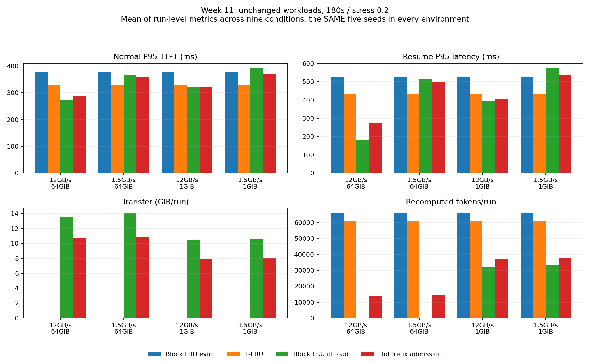

# 11주차: 부분 GPU 보관과 선택적 CPU 보관의 평가

평가일: 2026-11-12. [사전 계획](week11_policy_plan.md) · [구현 명세](week11_policy_implementation.md) · [실행된 노트북](../notebooks/week11_policy_review.ipynb) · [CSV·manifest·검증 자료](data/week11).

## 결과 요약

**T-LRU는 GPU에서 삭제·재계산하는 같은 block LRU보다 실제 지연을 줄였다.** 180초·stress 0.2의 9조건·15seed 평균에서 normal P95는 385.2→342.6ms, 복귀 P95는 547.3→450.2ms로 감소했다. 다만 빠른 PCIe·넉넉한 CPU 환경의 offload 기준선보다 빠르다는 결과는 아니다.

**HotPrefix 선택적 CPU 보관은 전송량을 줄였지만 기본 환경의 지연을 악화시켰다.** 같은 설정에서 block LRU offload 대비 전송량은 15.06→11.98GiB/run으로 약 20.5% 줄었지만 normal P95는 270.5→292.5ms, 복귀 P95는 184.1→280.2ms로 증가했다. 느린 PCIe에서는 이 trade-off의 방향이 달라지는 조건이 있었다.

따라서 '두 새 정책이 기존 정책보다 우수하다'고 결론 내리지 않는다. **부분 보관의 회수 판단과 CPU 보관 여부의 판단을 분리해야 하며, copy 절약이 서비스 지연 개선을 뜻하지 않는다.**

이 결과는 KV-Bench의 예약·FIFO·고정 처리량 모델에 대한 것이다. HotPrefix는 §3.2–3.3의 정책 실험이며 선제 승격·CUDA pipeline·cross-session 공유를 포함한 전체 시스템 재현이 아니다.

## 실험 범위와 통제

| 구분 | 설정 | 실행 수 |
|---|---|---:|
| 주 평가 | 기존 3설정 × 기존 9조건 × seed 0–14 × 11정책/기준선 | 4,455 |
| 환경 민감도 | 3설정 × 9조건 × seed 0–4 × 추가 3환경 × 5정책 | 2,025 |
| 정책 ablation | 3설정 × 9조건 × seed 0–4 × 6변형 | 810 |
| 합계 | | **7,290** |

설정은 60s/0.2, 180s/0.2, 180s/0.3이며 기존 JSON을 바꾸지 않았다. 조건은 W0 1x 및 W1·W2_BURST·W2_WAIT·W2 각각 2x/4x다. 2x/4x는 기존 생성기의 도구 대기 배율이며 도착률 배율이 아니다. 지원 가능한 모든 1x/8x 조합을 추가한 실험은 아니다.

주 평가는 기존 7정책과 `prefix_lru_evict`, `prefix_lru_offload`, `tlru`, `hotprefix_admission`을 포함한다. 서로 다른 source trace는 405개이며 같은 설정·조건·seed는 정책과 PCIe/CPU 환경이 달라도 같은 입력을 사용한다. 생성기나 도구 종류를 추가하지 않았다.

- **T-LRU ↔ block LRU evict:** 같은 block 회수·GPU-only 재계산 모델에서 판단을 비교한다.
- **HotPrefix admission ↔ block LRU offload:** 같은 GPU LRU 순서에서 CPU 보관 여부·교체를 비교한다.
- 기존 whole-session LRU와 새 block LRU의 차이는 회수 단위·in-flight 처리·CPU 교체의 차이도 포함하므로 새 정책 효과로 합치지 않는다.
- 새 정책 입장 상한은 100%. GPU 90% SLO 통과 수를 우수성 근거로 쓰지 않는다.
- 기본값은 사전 고정: T-LRU 200ms/Q_hat 160tokens, HotPrefix F=2/max_age=15/100-request aging. 좋은 결과를 보고 기본값을 바꾸지 않았다.

모든 평균은 **run별 P95·비용을 조건·seed에 걸쳐 평균낸 값**이다. 전체 요청을 합친 P95가 아니다. paired CSV의 ALL9 CI는 같은 seed 안에서 먼저 9조건을 평균내고 seed 단위 bootstrap 2,000회로 계산했다. 환경 간 비교는 기본 환경도 seed 0–4로 맞췄다.

## 기본 환경: T-LRU

단위 ms, 재계산은 tokens/run. 각 행은 9조건×15seed 평균이다.

| 설정 | block LRU normal P95 | T-LRU normal P95 | block LRU 복귀 P95 | T-LRU 복귀 P95 | 재계산 LRU→T-LRU |
|---|---:|---:|---:|---:|---:|
| 60s/0.2 | 329.5 | 314.8 | 272.5 | 209.3 | 10,252→9,005 |
| 180s/0.2 | 385.2 | 342.6 | 547.3 | 450.2 | 72,957→67,267 |
| 180s/0.3 | 759.5 | 715.2 | 974.3 | 895.3 | 199,807→192,222 |

180s/0.2에서 normal P95는 약 11.1%, 복귀 P95는 약 17.7%, 재계산량은 약 7.8% 감소했다. CPU 전송은 두 정책 모두 0이다. **같은 회수량에서도 어떤 요청의 prefix를 남기는지가 실제 지연과 전체 재계산량에 영향을 줄 수 있다.**

하지만 모든 조건의 효과가 같은 것은 아니다. 180s/0.2의 both_4x에서 복귀 P95는 평균 632.3→617.7ms였지만, paired 차이의 95% CI는 [-52.2, +19.5]ms로 0을 포함해 해당 조건만의 개선은 분명하지 않았다. 각 run에서 선택된 실제 P95 요청의 평균 구성은 다음과 같다.

| 정책 | 입장 | 복원 | prefill 대기 | 자기 prefill | 복귀 P95 |
|---|---:|---:|---:|---:|---:|
| block LRU evict | 0.0 | 0.0 | 130.1 | 502.2 | 632.3 |
| T-LRU | 0.0 | 0.0 | 222.1 | 395.6 | 617.7 |

성분은 한 행 안에서 같은 P95 요청의 값이며 정책 사이에는 선택된 요청이 다를 수 있다. 자기 prefill이 작아져도 FIFO 대기가 커지면 전체 복귀 지연 개선이 제한되는 모습이다. **재계산 토큰 수 감소를 곧바로 같은 비율의 응답 지연 감소로 해석할 수 없다.**

## 기본 환경: HotPrefix 선택적 CPU 보관

단위 ms, 전송은 GiB/run. 같은 GPU block LRU 순서의 비교다.

| 설정 | LRU normal P95 | HotPrefix normal P95 | LRU 복귀 P95 | HotPrefix 복귀 P95 | 전송 LRU→HotPrefix | 추가 재계산 |
|---|---:|---:|---:|---:|---:|---:|
| 60s/0.2 | 308.0 | 314.1 | 125.9 | 170.7 | 2.16→1.62 | 2,617 |
| 180s/0.2 | 270.5 | 292.5 | 184.1 | 280.2 | 15.06→11.98 | 15,029 |
| 180s/0.3 | 448.5 | 497.2 | 311.4 | 470.9 | 40.43→30.88 | 46,863 |

전송량은 줄었지만 기본 PCIe 12GB/s에서는 재계산이 추가되면서 지연이 악화됐다. 두 기본 새 정책은 주 평가·하드웨어 평가에서 stress 완료율 100%, normal 거절률 0%였으므로 이 차이를 더 많은 거절로 완료 요청만 선별한 효과로 설명할 수는 없다.

**해석:** 현재 stress 세션은 3–5턴이고 중간 도구 호출 뒤 반드시 복귀한다. 첫 접근이라 frequency가 낮아도 다음 요청에서 긴 prefix를 다시 사용한다. 그러므로 과거 접근 횟수가 낮다는 이유로 CPU 보관을 거절하면 실제로 다시 필요한 KV를 버릴 수 있다. 이는 현재 워크로드와 정책의 적합성에 대한 관측이며 HotPrefix 논문의 공유 prefix 서빙 전체가 나쁘다는 결론이 아니다.

## PCIe·CPU 민감도

180s/0.2, 같은 seed 0–4, 9조건 평균. 단위 ms/GiB.

| PCIe·CPU | LRU normal | HotPrefix normal | LRU 복귀 | HotPrefix 복귀 | 전송 LRU→HotPrefix |
|---|---:|---:|---:|---:|---:|
| 12GB/s·64GiB | 275.0 | 289.7 | 182.6 | 272.2 | 13.59→10.74 |
| 1.5GB/s·64GiB | 366.9 | 357.8 | 517.8 | 498.4 | 14.02→10.90 |
| 12GB/s·1GiB | 322.7 | 322.9 | 394.6 | 403.8 | 10.39→7.93 |
| 1.5GB/s·1GiB | 391.2 | 369.0 | 573.1 | 536.9 | 10.60→7.98 |

느린 PCIe에서는 전송 절약이 지연 감소로 연결된 평균 결과가 있었다. 1.5GB/s·64GiB의 복귀 차이는 -19.4ms [95% CI -29.1, -7.8]였지만 normal 차이 CI는 [-25.5, +2.0]ms로 0을 포함했다. 느린 PCIe·1GiB에서는 normal -22.1ms [-37.4, -8.8], 복귀 -36.2ms [-50.1, -21.9]였다. CPU 풀만 줄인 경우에는 두 지연의 CI가 모두 0을 포함했다. 'CPU가 작으면 선택적 보관이 항상 유리하다'고 일반화하지 않는다. 환경별 seed가 5개라는 한계도 있다. [동일 5seed paired 결과](data/week11/paired_hardware.csv).

CPU를 쓰지 않는 T-LRU와 block LRU evict는 같은 seed에서 PCIe/CPU 설정을 바꿔도 요청 기록이 정확히 같아야 한다. 이 음성 대조도 검증했다. 선택적 보관의 이점이 나타나도 그것만으로 GPU-only 전략보다 우수하다는 결론은 내리지 않는다.

## 정책 ablation

180s/0.2, 9조건×5seed. 같은 seed의 기본 T-LRU는 normal 328.4ms/복귀 432.2ms, 기본 HotPrefix는 289.7ms/272.2ms다.

| 변형 | normal P95 | 복귀 P95 | 전송 GiB | 재계산 tokens |
|---|---:|---:|---:|---:|
| T-LRU 100ms | 353.4 | 466.5 | 0 | 61,467 |
| T-LRU 200ms 기본 | 328.4 | 432.2 | 0 | 60,712 |
| T-LRU 400ms | 351.0 | 451.0 | 0 | 62,952 |
| HotPrefix F=1 | 275.0 | 182.6 | 13.59 | 4 |
| HotPrefix F=2 기본 | 289.7 | 272.2 | 10.74 | 14,261 |
| HotPrefix F=3 | 348.6 | 460.8 | 2.91 | 51,803 |
| HotPrefix + GPU hotness 순서 | 295.9 | 326.4 | 7.95 | 20,061 |
| CPU selective off | 275.0 | 182.6 | 13.59 | 0 |

CPU selective off는 같은 엔진의 block LRU offload와 replay가 같아야 하는 대조군이다. F=1은 여기서 거의 항상 보관하는 쪽에 가까웠고, F=3은 전송을 더 줄이지만 지연을 크게 악화시켰다. GPU hotness 순서를 추가해도 기본 admission-only보다 좋아지지 않았다. **현재 입력에서 frequency가 높다는 것이 빠른 복귀 또는 큰 지연 절약을 뜻하지는 않는다.**

T-LRU 200ms가 이 표에서 좋게 보이더라도 전역 최적값이라고 주장하지 않는다. 사전 기본값과 민감도를 보고한 것이며 학습/검증 seed를 나눈 최적화 실험이 아니다.

## 검증과 재현 자료

주 평가 ALL9의 paired 차이(후보−기준선)와 seed 단위 bootstrap 95% CI는 다음과 같다. 단위 ms. 조건별 단일 CI와 구분하며 복수 지표에 대한 동시 신뢰구간은 아니다.

| 설정 | T-LRU normal Δ [CI] | T-LRU 복귀 Δ [CI] | HotPrefix normal Δ [CI] | HotPrefix 복귀 Δ [CI] |
|---|---:|---:|---:|---:|
| 60s/0.2 | -14.7 [-26.2,-5.7] | -63.2 [-99.0,-29.8] | +6.2 [+0.2,+15.7] | +44.8 [+18.4,+75.2] |
| 180s/0.2 | -42.6 [-53.2,-32.9] | -97.1 [-123.2,-76.2] | +22.0 [+14.7,+30.2] | +96.1 [+70.7,+120.3] |
| 180s/0.3 | -44.3 [-56.6,-34.1] | -79.0 [-103.3,-53.8] | +48.7 [+38.3,+60.3] | +159.6 [+134.7,+183.0] |

- 전체 unit/integration 테스트 52개 통과. 작은 무작위 trace 120회는 매 이벤트 뒤 GPU/CPU 보존·용량·반환을 확인했다.
- 실제 미래 tool duration과 다음 prompt를 바꿔도 관측 전의 admission/reclaim 결정은 4개 새 정책/기준선에서 같았다.
- 기존 7정책 × 3설정 × 9조건 × 5seed = **945회**에서 수정 전후 기존 지표·요청·점유율·전체 이벤트 fingerprint가 모두 일치했다. [원본 fingerprint](data/week11/legacy_fingerprints.json), [검증 기록](data/week11/regression.json).
- source hash·실행 수·입력 동일성·대조군 검증은 [validation.json](data/week11/validation.json)에 있다.
- [summary.csv](data/week11/summary.csv): 실행별 지표. [comparison.csv](data/week11/comparison.csv): 조건별 평균·표준편차. [paired.csv](data/week11/paired.csv): 같은 trace/seed의 차이와 95% CI.
- raw trace/requests/occupancy 및 seed 0의 전체 events는 로컬 `results/week11_20261112`에 있다. raw는 git에서 제외하고 실행 스크립트·compact 결과·실행된 notebook·그림을 공유한다.

## 결론과 한계

1. **T-LRU:** 부분 보관량을 tail 목표에 맞춰 배분하는 판단은 같은 GPU-only block LRU보다 도움이 됐다. 다만 prefill FIFO 대기까지 함께 봐야 하며, 빠른 CPU offload를 보편적으로 대체한다는 근거는 없다.
2. **HotPrefix admission:** 전송량 절감은 확인했지만 기본 환경의 지연 개선은 확인하지 못했다. 느린 PCIe 조건에서는 일부 이득이 관측됐고 CPU 크기만으로 유불리를 판단할 수 없었다.
3. 후속 방향은 정책 이름 추가보다 **환경·워크로드에 맞는 보관 판단**과 **active 예약·prefill FIFO 병목의 분리**다. 이 결과만으로 새 적응형 결합 정책이 검증됐다고 주장하지 않는다.

실제 attention·생성 품질·CUDA overhead·동적 batching·레이어별 overlap은 측정하지 않았다. 각 논문의 전체 시스템 개선 수치와 이번 결과를 직접 비교하지 않는다. 더 긴 세션·미복귀·공유 prefix 환경으로의 일반화는 추가 실험이 필요하다.
